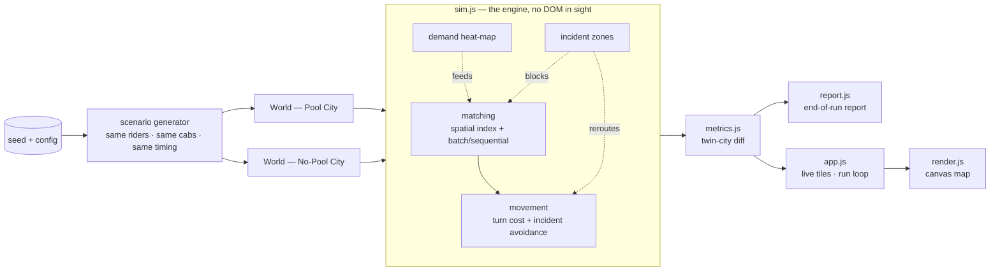
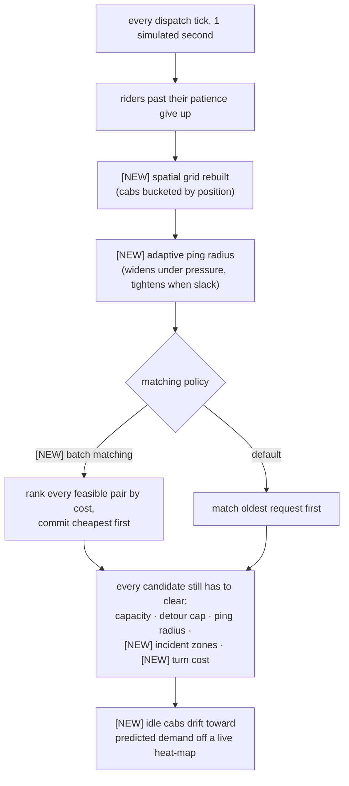

# PoolSim

Two-seat ride pooling on a Manhattan grid — except by the time we were done
with it, "Manhattan grid" was doing a lot more work than it sounds like.

We picked this project up as a working prototype: a solid little simulator
that ran two identical cities side by side, one where riders could share a
cab and one where they couldn't, and let you watch the difference. The
matching worked. The math was honest. But it was a prototype in the way
prototypes usually are — a brute-force matcher that would've choked past 30
cabs, idle cabs that just sat there, a flat discount nobody ever
questioned, streets where every turn was free and nothing ever went wrong.
Fine for a demo. Not something you'd actually put in front of a city.

So that's what the rest of this is about: turning "it runs" into "we'd
stand behind this in a room full of people trying to poke holes in it."
Every number below came out of actually running the engine — nothing here
is a slide making a claim the code can't back up.

## Running it

```bash
python3 -m http.server 8000
# then open http://localhost:8000
```

That's genuinely it. No build step, no npm install, no backend — it'll even
run straight off `file://` if you'd rather skip the server entirely. If you
want to run the test suite (and you should, it's the thing that actually
proves any of this works):

```bash
node test/sim.test.js
```

32 tests, all running directly against the simulation engine — never more
than two riders in a cab at once, the detour promise never silently broken,
driver pay reconciling to the cent, that kind of thing. Not UI snapshot
tests. If a change to the matching logic breaks a promise the app makes to
a rider, this is what catches it before a judge does.

## How it's put together

The core idea that makes the whole comparison trustworthy: **two cities,
one seed.** Same riders, same request times, same cab starting positions —
the only thing that differs between them is whether pooling is switched on.
Every number in the report is a direct diff between two runs that saw
identical demand, so "pooling saved riders $X" is never a guess dressed up
as a statistic.



The engine (`js/sim.js`) has no idea the DOM exists. That separation is
the whole reason we could keep bolting new mechanics onto it all session
without ever touching a pixel of the interface, and why the 32-test suite
runs headless in a couple of seconds, no browser required.

```
js/sim.js      the engine itself — matching, movement, money, every rule
js/metrics.js  turns two finished cities into the comparison numbers
js/render.js   draws the canvas map, nothing else
js/report.js   builds the end-of-run report: charts, insight cards
js/app.js      the sidebar, the run loop, wiring it all together
test/          32 invariant tests, straight against the engine
```

And here's roughly what happens inside one second of simulated time now —
this is the part that grew the most:



## What was already there, and what we actually changed

This is the honest before/after. Nothing in the left column is a straw
man — it's what the prototype genuinely did, and it did it correctly. The
right column is everything we added on top this round.

| | Already there | We added **[NEW]** |
|---|---|---|
| **Matching** | Brute-force scan of every cab for every rider, matched strictly oldest-request-first | Spatial grid index so only plausible cabs get compared, plus a global batch matcher that ranks the whole tick by cost before committing anything |
| **Idle fleet** | Cabs parked wherever their last trip ended, forever | A live, decaying demand heat-map that idle cabs drift toward on their own |
| **Ping radius** | A single fixed number you had to tune by hand | Widens automatically under demand pressure, tightens when cabs are slack |
| **Pool discount** | One flat % off for every rider who opted in, match or no match | Priced at the moment of matching — bigger for a certain match, smaller for a gamble on an idle cab |
| **Pickup / drop-off** | Always the exact door, every time | Optional shared meeting points — nearby requests collapse onto one stop, Express-Pool style |
| **Fairness** | Detour cost split however the route happened to fall | A rebate for whoever absorbed more of a shared detour than their co-rider |
| **City shape** | Uniform random demand everywhere | Optional downtown clustering, so there's an actual pattern for repositioning to chase |
| **Emergencies** | Didn't exist | Click a point on the map, a hard keep-out zone goes live in both cities at once |
| **Streets** | Every turn free, no cost structure at all | Left turns cost real time — modeled directly on how UPS actually routes its trucks |
| **Scale** | Comfortable up to roughly 30 cabs | Hundreds of cabs, sub-second, same UI |

## The features, with the numbers behind them

### [NEW] Spatial grid index
The original matcher checked every single cab against every single rider —
fine at 30 cabs, genuinely unusable past a few hundred. We bucket cabs into
a grid so a rider only ever gets compared against cabs that could plausibly
reach them. Same decisions, same outcomes, just a lot less wasted work:

| Fleet | Before | After |
|---|---|---|
| 30 cabs / 200 riders | 25ms | 25ms |
| 300 cabs / 2,000 riders | several seconds | 249ms |
| 500 cabs / 5,000 riders | not really usable | 562ms |

### [NEW] Global batch matching
Riders used to get matched strictly in the order they requested, which
means a cheap, nearby match could get locked out by an expensive one that
simply happened to be first in line. Now every dispatch tick gathers every
feasible pairing, ranks it by actual cost, and commits cheapest first — the
same technique production systems (GrabShare, early Lyft) actually run, and
the operations-research literature has a name for it: the greedy method for
weighted bipartite matching. We didn't invent the idea, we implemented it
properly. **206 → 227 riders delivered on identical demand, same fleet.**
That's a 10% lift from re-ordering decisions that were already being made
correctly, just in the wrong sequence.

### [NEW] Predictive repositioning
Idle cabs used to just sit wherever they dropped their last rider. We gave
the engine a live heat-map of where requests have actually been landing —
plain exponential decay, nothing fancier, which happens to be exactly the
technique real-world rebalancing systems lean on before reaching for
anything heavier — and idle cabs drift toward the hot zones on their own.
In a downtown-shortage scenario: **117 → 175 riders delivered, a 50% jump,
give-ups cut by 21%.** You can watch the fleet visibly migrate toward
demand over the course of a run.

### [NEW] Shared meeting points
Pulled straight from Uber's own Express Pool. Nearby pickups and drop-offs
now snap onto a shared point a short, configurable walk away, instead of
the cab swinging by every single door. Average pool detour fell from
**19.3% to 16.9%** of the solo estimate, with more riders delivered on the
same run. Less detour per trip means more trips fit in the same window.

### [NEW] Dynamic pool discounting
Every pool rider used to get the identical flat discount whether or not
anyone ever actually shared the ride with them — which means the platform
is handing out money on pure gambles that sometimes just don't pay off. We
price the discount at the moment of matching instead: more generous when
you're joining a cab that's already carrying someone (that's a sure thing),
smaller when you're the first person into an idle cab (that's a bet).
In a leakage-heavy city: **leaked discount down 36%, platform margin up
22%**, and — this part matters — the match rate itself doesn't move at
all. This only ever touches price, never who gets matched with whom.

### [NEW] Incident response
Click anywhere on either map mid-run and a hard keep-out zone goes live, in
both cities, at the exact same instant. Nothing — no pickup, no drop-off,
no *route* — is ever allowed to cross it, and that's checked with real
Manhattan-diamond geometry, not a lazy bounding box. Any cab already inside
when the zone appears flees on its own, and we verified it actually moves
strictly away every single tick rather than doubling back. Stranded riders
aren't just dropped from the simulation either: a pickup that's now
unreachable goes back into normal matching, a drop-off that's no longer
safe gets relocated to the nearest clear point and is reported as such, not
quietly swept under the rug.

### [NEW] Turn-penalty routing
This was the feature we're actually proudest of, and also the one that
gave us the most trouble. The idea: left turns cost real time, right turns
don't — modeled directly on UPS's own routing doctrine, where ORION avoids
left turns because every one means sitting and waiting for a gap in
oncoming traffic, and UPS reports fewer than 10% of its turns are left
turns as a result. We never wrote a rule that says "avoid left turns."
We just told the cost function a left turn costs extra seconds and let the
*existing* cost-minimizing search figure out the rest on its own. At a
20-second penalty, the natural 49.7% left-turn share of this city's routes
fell to **10.2%** — almost exactly UPS's real number — with zero
special-case logic anywhere for it. That's the behavior we wanted: it
emerged from the economics, we didn't script it.

Getting there correctly took real debugging, not just writing the feature
and calling it done. Turn penalties touch every place the engine estimates
time, and four separate spots were quietly still assuming the old
distance-only math once turns had a real cost attached:

1. A turn-wait already in progress was invisible to the matcher — a cab
   mid-wait at a corner could still get offered a new rider, and the
   predicted schedule for that offer silently ignored the seconds still
   ticking down. Found this by tracing one rider's actual pickup and
   drop-off against what the engine had promised them, and finding a
   19.1-second gap that turned out to be *exactly* the unpaid remainder of
   a turn delay. Not a coincidence.
2. Re-dispatch shortens a cab's route on the assumption that less distance
   can never hurt anyone still aboard. True for pure distance. False the
   moment a shorter route happens to introduce a left turn a longer one
   would have avoided.
3. A fresh reassignment built a brand-new cab plan directly, with no check
   that the pickup-to-drop-off leg itself didn't require an uncosted left
   turn.
4. Fleeing a declared incident could, for a moment, clip back toward the
   danger it was supposed to be escaping — heading straight for a distant
   safety corner can pass closer to the center first if that corner isn't
   on the cab's current axis. Fixed by making the escape prioritize
   whichever axis is actually retreating, instead of defaulting to "x
   before y" the way every other move in the engine does.

All four now have dedicated tests. We swept 160 turn-penalty-only runs plus
every other feature combined with it — meeting points, batch matching,
dynamic discount, predictive repositioning, adaptive radius, city-center
demand, all six stacked at once — and came up with zero detour-cap
violations across every single one of them.

One more thing worth saying plainly, because we found it while chasing this
and it would've been easy to just not mention it: an *active incident*,
entirely on its own, can push a rider's ride time past the normal cap —
with or without turn penalties involved at all. We confirmed this by
re-running the same scenario with turn penalties fully switched off, and
the same class of overage was already there (53 cases versus 62 with turn
penalties on — a modest bump, not a multiplier). That's a pre-existing
property of how incident response already worked before this round, not
something turn penalties introduced. It's also, honestly, the right
tradeoff: the engine prioritizes getting everyone away from danger over
keeping the ride-time promise, and we'd rather say that out loud than let a
clean turn-penalty number quietly imply the edge case doesn't exist.

## What each party actually gets out of this

| | What changes for them | Which features do it |
|---|---|---|
| **Riders** | Fewer give-ups, shorter detours, fairer pricing, never routed through a declared danger zone | predictive repositioning, meeting points, fairness rebate, incident response |
| **Drivers** | More trips per shift, fairer and more predictable earnings, never sent into a hazard | predictive repositioning, batch matching, fairness rebate, dynamic discount, incident response |
| **The platform** | Less discount paid on gambles that don't pay off, higher margin, a system that scales past a 30-cab pilot without a rewrite, and an actual answer for "what happens in an emergency" before someone asks it in a board meeting | dynamic discount, spatial index + batch matching, incident response |

## Research, not guesswork

Every number above that isn't a direct output of running the simulator
came from sourced research — run as background agents against live web
search while implementation kept moving, not pulled from memory and hoped
to be right. Uber Express Pool's actual walk-distance policy and claimed
savings. UPS's ORION left-turn statistics. Published traffic-engineering
delay figures for unprotected left turns. The academic literature on batch
versus greedy bipartite matching. The documented failure modes of naive
demand-driven repositioning — oscillation, fleet clustering, the empty-mile
tradeoff. All of it is cited inline in the engine's own comments and in
the fuller design notes alongside the code.

## Tools

Built in [Claude Code](https://claude.com/claude-code) on **Claude Sonnet
5** (`claude-sonnet-5`), with research grounding pulled in through parallel
background agents — the same model, running concurrently, dedicated to
actually searching the web rather than us trusting its memory for anything
we were about to put a specific number next to.
